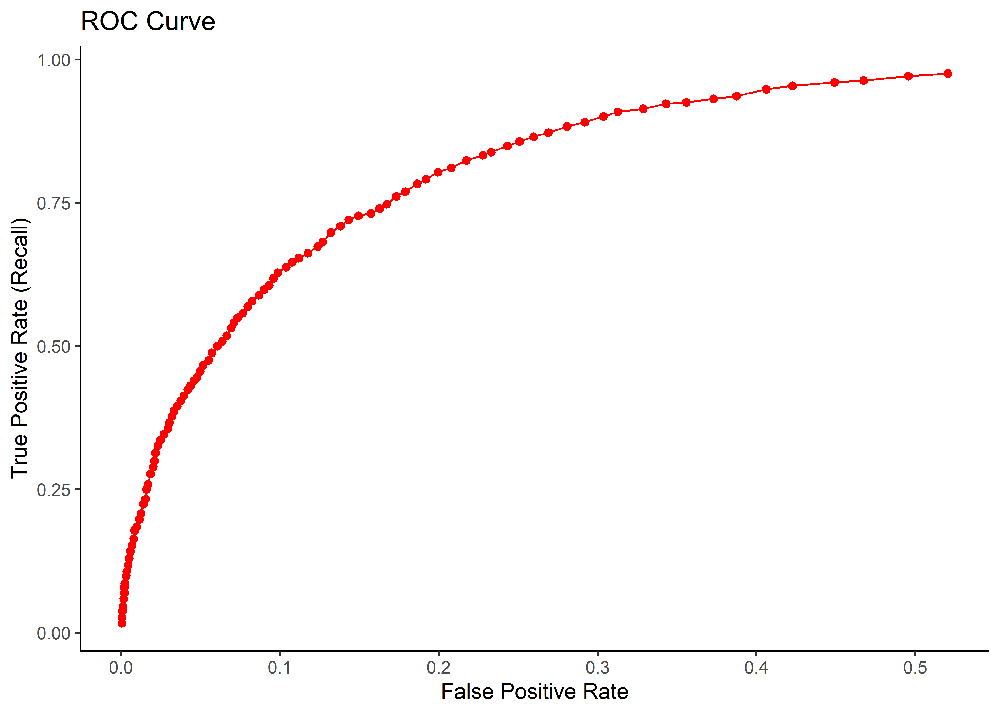
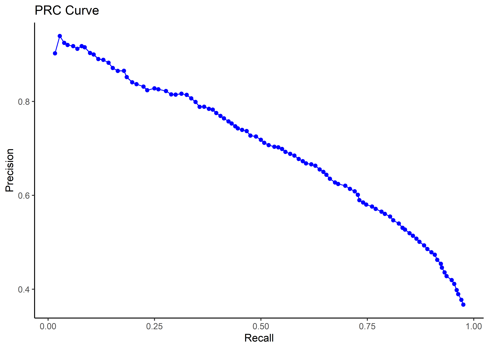

# m6APrediction

`m6APrediction` predicts **N6-methyladenosine (m6A)** RNA modification sites
from sequence and structural features. It packages a random forest classifier
trained on 48,055 annotated candidate sites (11,248 positive, 36,807 negative)
behind two documented functions:

| Function | What it does |
| --- | --- |
| `prediction_multiple()` | Scores a table of candidate sites and adds `predicted_m6A_prob` and `predicted_m6A_status` to every row |
| `prediction_single()` | Scores one site from seven feature values and returns a short named vector |

## Why this is useful

m6A is the most abundant internal modification of eukaryotic mRNA and
influences splicing, stability, translation and decay. Experimental mapping
(MeRIP-seq, miCLIP) is expensive, so a model that ranks candidate sites from
cheap sequence and annotation features helps decide which positions are worth
following up in the wet lab. The model reaches an AUROC of 0.885 and an AUPRC
of 0.701 on held-out data, well above the 0.236 prevalence baseline.

## Installation

From GitHub:

```r
# remotes is the light-weight option
install.packages("remotes")
remotes::install_github("hanRDST/m6APrediction")

# or, with devtools
# devtools::install_github("hanRDST/m6APrediction")
```

From the package archive (`.tar.gz`):

```r
install.packages("m6APrediction_1.0.0.tar.gz", repos = NULL, type = "source")
```

The package requires R (>= 3.5.0) and imports `randomForest` and `stats`.

## Quick start

```r
library(m6APrediction)

# The fitted model and a 100-row example table ship with the package.
ml_fit <- readRDS(system.file("extdata", "rf_fit.rds",
                              package = "m6APrediction", mustWork = TRUE))
example_df <- read.csv(system.file("extdata", "m6A_input_example.csv",
                                   package = "m6APrediction", mustWork = TRUE))

# 1. Score a table of candidate sites.
result <- prediction_multiple(ml_fit, example_df[1:5, ],
                              positive_threshold = 0.6)
result[, c("DNA_5mer", "predicted_m6A_prob", "predicted_m6A_status")]
#>   DNA_5mer predicted_m6A_prob predicted_m6A_status
#> 1    GAACA              0.876             Positive
#> 2    GAACC              0.000             Negative
#> 3    AAACT              0.498             Negative
#> 4    GGACT              0.938             Positive
#> 5    GGACT              0.208             Negative

# 2. Score a single site.
prediction_single(ml_fit,
                  gc_content = 0.6,
                  RNA_type = "mRNA",
                  RNA_region = "CDS",
                  exon_length = 12,
                  distance_to_junction = 5,
                  evolutionary_conservation = 0.8,
                  DNA_5mer = "GGACA",
                  positive_threshold = 0.5)
#>  predicted_m6A_prob predicted_m6A_status
#>               "0.51"           "Positive"
```

## Input features

`prediction_multiple()` expects one row per candidate site with these columns:

| Column | Type | Meaning |
| --- | --- | --- |
| `gc_content` | numeric, 0--1 | GC content of the sequence window |
| `RNA_type` | character / factor | `mRNA`, `lincRNA`, `lncRNA` or `pseudogene` |
| `RNA_region` | character / factor | `CDS`, `intron`, `3'UTR` or `5'UTR` |
| `exon_length` | numeric | log2-transformed length of the hosting exon |
| `distance_to_junction` | numeric | log2-transformed distance to the nearest exon-exon junction |
| `evolutionary_conservation` | numeric, 0--1 | cross-species conservation score |
| `DNA_5mer` | character | five-nucleotide context with an adenine in the central position (e.g. `GGACA`) |

Two details are easy to get wrong:

- `exon_length` and `distance_to_junction` are **already log2-transformed**; do
  not transform them again.
- A site is labelled `Positive` only when its probability is **strictly
  greater** than `positive_threshold`; a probability exactly equal to the
  threshold is `Negative`.

## Bundled data

| File | Contents |
| --- | --- |
| `inst/extdata/rf_fit.rds` | 500-tree random forest fitted with `randomForest` (15.2 MB) |
| `inst/extdata/m6A_input_example.csv` | 100 example feature rows, 7 columns |

Both are reached with `system.file("extdata", "<file>", package = "m6APrediction")`.
Note the `extdata` prefix: the contents of `inst/` are copied into the installed
package root, so `inst` must not appear in the path.

## Model performance

The classifier was evaluated on a held-out 20% test set (9,611 sites) during
the model-evaluation practical, where it reached an AUROC of 0.885 and an AUPRC
of 0.701. Out-of-bag predictions from the bundled model agree closely
(AUROC 0.887, AUPRC 0.702).





## Documentation

```r
?prediction_multiple
?prediction_single
```

## License

MIT.
